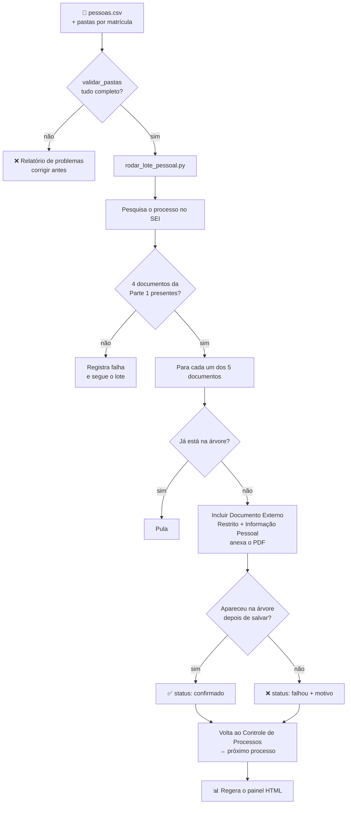

<div align="center">

# 📎 Automação SEI — Parte 2: Documentos Pessoais

**Anexa em lote os documentos pessoais de centenas de servidores, cada um no seu processo do SEI, com validação antes da execução, rastreio por documento e painel de acompanhamento.**

[](https://www.python.org/)
[](https://playwright.dev/python/)
[](https://pandas.pydata.org/)

[](LICENSE)

**Série:** [Parte 1: Criação de processos](https://github.com/ThiagoDionisio05/sei-automacao) •
**Parte 2: Documentos pessoais** •
[Parte 3: Documentos nativos personalizados](https://github.com/ThiagoDionisio05/sei-automacao-pt3)

</div>

---

## 📌 Visão geral

A [Parte 1](https://github.com/ThiagoDionisio05/sei-automacao) cria os processos
no SEI com os documentos padrão. Esta segunda parte completa cada processo com
os **documentos pessoais do servidor**. São 5 PDFs por pessoa, e o lote tem
**cerca de 720 pessoas**:

| Documento | Arquivo esperado na pasta da pessoa |
|---|---|
| Cadastro de dados pessoais | `dados_pessoais.pdf` |
| Cadastro de dados funcionais | `dados_funcionais.pdf` |
| Ficha financeira | `ficha_financeira.pdf` |
| Declaração de não ajuizamento de ação judicial | `termos_de_nao_ajuizamento.pdf` |
| Planilha de cálculo | `planilhaCalculo.pdf` |

Fazer isso à mão significaria anexar **milhares de arquivos**, um por um. O
risco de anexar o documento de uma pessoa no processo de outra é real, e um
erro assim expõe dados pessoais.

### Destaques

| | |
|---|---|
| 🛫 **Validação antes da execução** | Antes de tocar no SEI, confere se todas as pessoas da planilha têm a pasta completa, e aponta matrículas duplicadas e pastas sem dono |
| 🔒 **Dado pessoal tratado como dado pessoal** | Todo documento entra com nível de acesso **Restrito** e hipótese legal "Informação Pessoal" |
| 🧷 **Trava de segurança entre etapas** | Só anexa se os 4 documentos da Parte 1 já estiverem no processo |
| ♻️ **Idempotente** | Documentos que já estão na árvore são pulados; rodar de novo não duplica nada |
| 📋 **Rastreio por documento** | Cada documento fica registrado como `confirmado` ou `falhou`, com o motivo do erro |
| 📊 **Painel gerado automaticamente** | HTML com a situação de cada pessoa, montado a partir do que a automação **confirmou** no SEI |

---

## ⚙️ Como funciona



### Organização dos arquivos de entrada

Cada pessoa tem uma pasta nomeada com a **matrícula**, e não com o nome. Isso
evita problemas com acentos, espaços, nomes iguais e caminhos longos no
Windows:

```
data/
├── pessoas.csv                 # 1 linha por pessoa (coluna "Matrícula")
└── documentos_pessoais/
    ├── 1234567/                # pasta = matrícula
    │   ├── dados_pessoais.pdf
    │   ├── dados_funcionais.pdf
    │   ├── ficha_financeira.pdf
    │   ├── termos_de_nao_ajuizamento.pdf
    │   └── planilhaCalculo.pdf
    └── 7654321/
        └── ...
```

> [!IMPORTANT]
> A pasta `data/` inteira fica fora do repositório (`.gitignore`): ela contém
> dados pessoais reais. Os números de matrícula acima são fictícios.

---

## 🧠 Decisões técnicas

<details>
<summary><b>1. Validação antes da execução (pre-flight)</b></summary>

<br>

Descobrir uma pasta faltando na pessoa 487 de 720, no meio do lote, custa
caro. Por isso [`validar_pastas.py`](src/validar_pastas.py) roda **antes** e
reporta tudo de uma vez:

- matrícula sem pasta;
- pasta com documento faltando (lista **todos** os arquivos ausentes, não só o primeiro);
- matrícula duplicada na planilha;
- pasta "órfã", sem matrícula correspondente (geralmente um erro de digitação).

O script devolve código de saída `0` ou `1`, então pode ser usado como etapa
de um pipeline.

</details>

<details>
<summary><b>2. Ler a planilha sem perder zeros à esquerda</b></summary>

<br>

Matrículas como `0123456` viram `123456` se o pandas tratar a coluna como
número, e aí a pasta não é encontrada. A leitura força tudo como texto:

```python
pd.read_csv(caminho, dtype=str, keep_default_na=False,
            sep=None, engine="python", encoding="utf-8-sig")
```

- `dtype=str`: preserva os zeros à esquerda;
- `sep=None`: detecta sozinho se o separador é `,` ou `;` (o Excel em português exporta com `;`);
- `utf-8-sig`: remove o BOM que o Excel grava e que "grudaria" no nome da primeira coluna.

</details>

<details>
<summary><b>3. Arquivos encontrados pelo nome, não pela ordem</b></summary>

<br>

A ordem em que o sistema operacional lista arquivos **não é garantida**.
Associar "1º arquivo = dados pessoais" poderia anexar a ficha financeira no
lugar errado. Cada documento tem um nome fixo, definido em
[`config.py`](src/config.py) (`DOCUMENTOS_PESSOAIS`).

</details>

<details>
<summary><b>4. Uma etapa só roda se a anterior estiver completa</b></summary>

<br>

Antes de anexar qualquer coisa, [`verificar_documentos_padrao.py`](src/verificar_documentos_padrao.py)
confere se os 4 documentos da Parte 1 estão na árvore do processo. Se não
estiverem, o processo é pulado e a falha é registrada. Isso evita completar
um processo que nasceu com problema.

</details>

<details>
<summary><b>5. Status como fonte da verdade, e um painel gerado a partir dele</b></summary>

<br>

[`status_documentos.py`](src/status_documentos.py) grava, para cada matrícula,
o processo usado e a situação de cada documento:

```json
{
  "1234567": {
    "processo_sei": "00000.000000/0000-00",
    "documentos": {
      "dados_pessoais": { "status": "confirmado", "atualizado_em": "..." },
      "ficha_financeira": { "status": "falhou", "erro": "..." }
    }
  }
}
```

Um documento só vira `confirmado` depois de **aparecer na árvore do SEI**,
e não apenas depois de clicar em "Salvar". O painel
([`gerar_painel.py`](src/gerar_painel.py)) é **gerado** a partir desse
arquivo e da planilha, nunca editado à mão. Ele é regerado num bloco
`finally`, para refletir o estado real mesmo quando o lote falha.

</details>

<details>
<summary><b>6. Exceções próprias, com mensagens que dizem o que fazer</b></summary>

<br>

[`documentos_pessoais.py`](src/documentos_pessoais.py) define
`PastaPessoaNaoEncontrada` e `DocumentosPessoaIncompletos`. Assim, a
validação consegue separar os tipos de problema, e cada mensagem já diz como
corrigir ("confira se o nome da pasta bate exatamente com a matrícula...").

</details>

---

## 🚀 Como rodar

### Pré-requisitos

- Python 3.10+, Google Chrome e acesso a uma instância do SEI
- Processos já criados pela [Parte 1](https://github.com/ThiagoDionisio05/sei-automacao)

### 1. Instalação

```powershell
git clone https://github.com/ThiagoDionisio05/sei-automacao-pt2.git
cd sei-automacao-pt2
python -m venv .venv
.venv\Scripts\activate
pip install -r requirements.txt
playwright install chromium
copy src\config_local.example.py src\config_local.py   # preencha com seus dados
```

### 2. Prepare os dados e valide

Monte `data/pessoas.csv` e as pastas em `data/documentos_pessoais/` como
mostrado acima, e rode:

```powershell
python -m src.validar_pastas
```

Só siga em frente quando aparecer **"TUDO OK — pode rodar o lote."**

### 3. Abra o Chrome com depuração remota e faça login no SEI

```powershell
& "C:\Program Files\Google\Chrome\Application\chrome.exe" `
  --remote-debugging-port=9222 `
  --remote-debugging-address=127.0.0.1 `
  --user-data-dir="C:\ChromeSEIAutomacao"
```

> [!WARNING]
> A porta 9222 não tem autenticação. Abra essa janela **só durante a
> execução** e feche-a ao terminar.

### 4. Execute

| Comando | O que faz |
|---|---|
| `python -m src.validar_pastas` | Confere planilha e pastas antes de tudo |
| `python main.py --numero <processo>` | Só pesquisa e abre o processo (teste de conexão) |
| `python -m src.verificar_documentos_padrao --numero <processo>` | Confere se a Parte 1 está completa no processo |
| `python testar_documento_pessoal.py <processo> <matrícula> <documento...>` | Anexa um ou mais documentos de uma pessoa |
| `python rodar_lote_pessoal.py <processo> <matrícula> [<processo> <matrícula> ...]` | Roda o lote completo |
| `python -m src.gerar_painel` | Regera o painel `painel_documentos.html` |

Os nomes de documento aceitos são `dados_pessoais`, `dados_funcionais`,
`ficha_financeira`, `termos_de_nao_ajuizamento` e `planilha_calculo`.

> [!NOTE]
> A automação **nunca assina documentos**. A assinatura é sempre manual.

---

## 📁 Estrutura do projeto

```
sei-automacao-pt2/
├── main.py                          # Teste de conexão: pesquisa e abre um processo
├── rodar_lote_pessoal.py            # Lote: vários processos numa única sessão
├── testar_documento_pessoal.py      # Anexa documentos de uma pessoa
├── requirements.txt
└── src/
    ├── config.py                    # Caminhos, mapeamento dos 5 documentos, nível de acesso
    ├── config_local.example.py      # Modelo para os dados reais (não versionados)
    ├── browser.py                   # Conexão com o Chrome via CDP
    ├── sei_page.py                  # Helpers: frames, pesquisa, cliques, anexos, verificações
    ├── documentos_pessoais.py       # Matrícula → pasta → 5 PDFs (com exceções próprias)
    ├── documento_pessoal.py         # Inclusão e verificação de cada documento no SEI
    ├── validar_pastas.py            # Validação antes da execução
    ├── verificar_documentos_padrao.py  # Trava: a Parte 1 está completa?
    ├── status_documentos.py         # Registro confirmado/falhou por documento
    └── gerar_painel.py              # Gera o painel HTML a partir do status
```

---

## 📚 O que aprendi

- **Validar antes de executar**: em lotes grandes, o erro mais barato é o que
  se descobre antes de começar.
- **Dados vindos do Excel**: zeros à esquerda, separador `;`, BOM. Detalhes
  pequenos que quebram uma automação inteira.
- **Fonte única da verdade**: o painel mostra o que foi confirmado no
  sistema, não o que "deveria" ter acontecido.
- **LGPD na prática**: nível de acesso restrito, dados pessoais fora do
  repositório, identificadores fictícios na documentação.

---

## ⚠️ Aviso

Projeto independente, criado para uso pessoal e fins de estudo. **Não é
afiliado nem endossado** por nenhum órgão público ou pelos mantenedores do SEI.
Use apenas em sistemas aos quais você tem acesso autorizado e de acordo com as
políticas da sua instituição. Nenhum dado pessoal real faz parte deste
repositório.

<div align="center">

Feito por **Thiago Dionisio** · [GitHub](https://github.com/ThiagoDionisio05)

</div>
